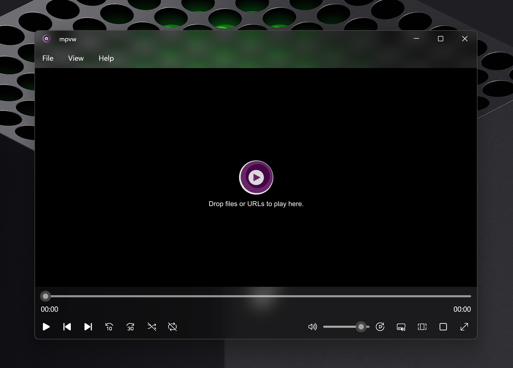

# mpv-winui-player

base on [mpv](https://github.com/mpv-player/mpv/) and [WinUI 3](https://github.com/microsoft/microsoft-ui-xaml).

## Screenshot



## Download
[Github Actions](https://github.com/ikas-mc/mpv-winui-player/actions/workflows/build.yml)

[Github Releases](https://github.com/ikas-mc/mpv-winui-player/releases)

### mpvw-msix-x64-Release
MSIX installer package

### mpvw-unpackaged-x64-Release
Unpackaged, can run directly after extracting

### mpvw-app-data-sample
Default configuration files, needs to be copied to the application's AppData directory

## Limitation

### menu.conf

Some commands aren't supported, like quit and window related cmd...


### vo

The player uses the `d3d11-output-mode=composition` mode, ~~mpv can't get display information~~.

The new version now supports getting monitor color info, but you have to use the built-in mpv.dll.  

The app registers a custom property to mpv: `"user-data/mpvw/color-kind"`, which supports the following values:  

`SDR`:  
`HDR`: HDR Enabled  
`WCG`: Auto Color Management (ACM) Enabled

Sample:

```ini
[mpvw-hdr]
profile-cond=p["user-data/mpvw/color-kind"] == "HDR"
profile-restore=copy
target-colorspace-hint=yes
target-colorspace-hint-mode=source

[mpvw-wcg]
profile-cond=p["user-data/mpvw/color-kind"] == "WCG"
profile-restore=copy
target-colorspace-hint=yes
target-colorspace-hint-mode=source

[mpvw-sdr]
profile-cond=p["user-data/mpvw/color-kind"] == "SDR"
profile-restore=copy
```

## Thumbnail Preview

* Built-in preview
* Supports plugins using [osc-preview-api](https://mpv.io/manual/master/#osc-preview-api)


## Msix or Unpackaged

|  | Msix | Unpackaged |
| :--- | :--- | :--- |
| **Data** | `C:\Users\user\AppData\Local\Packages\--\LocalState` | `C:\Users\user\AppData\Local\ikas-mc\mpvw` |
| **Settings** | `C:\Users\user\AppData\Local\Packages\--\Settings` | `HKEY_CURRENT_USER\Software\Classes\Local Settings\Software\ikas-mc\mpvw\app` |
| **File Association** | Auto | Register in the settings page |
| **Protocol** | mpvw://?file=[path] | Register in the settings page |
| **Command Line** | mpvw [path] | [App Folder]\mpvw.exe [path] |


## Mpv Conf Editor

https://github.com/ikas-mc/mpv-winui-player/wiki/Mpv-Conf-Editor

## License

GPL-3.0 — see [LICENSE.txt](LICENSE.txt)

This app copied some code from [mpv](https://github.com/mpv-player/mpv)

The built-in mpv dll is compiled with GPL enabled [mpv-windows-builder](https://github.com/ikas-mc/mpv-windows-builder)
